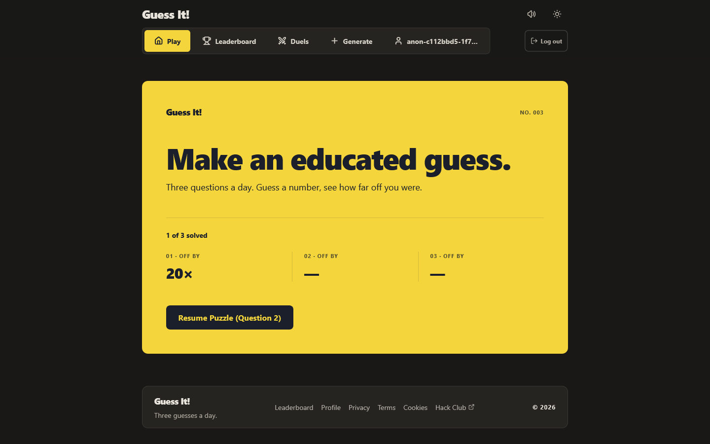
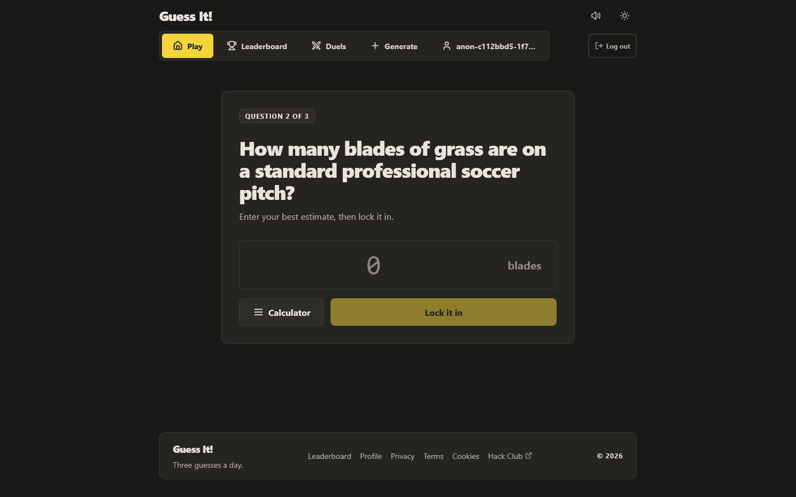
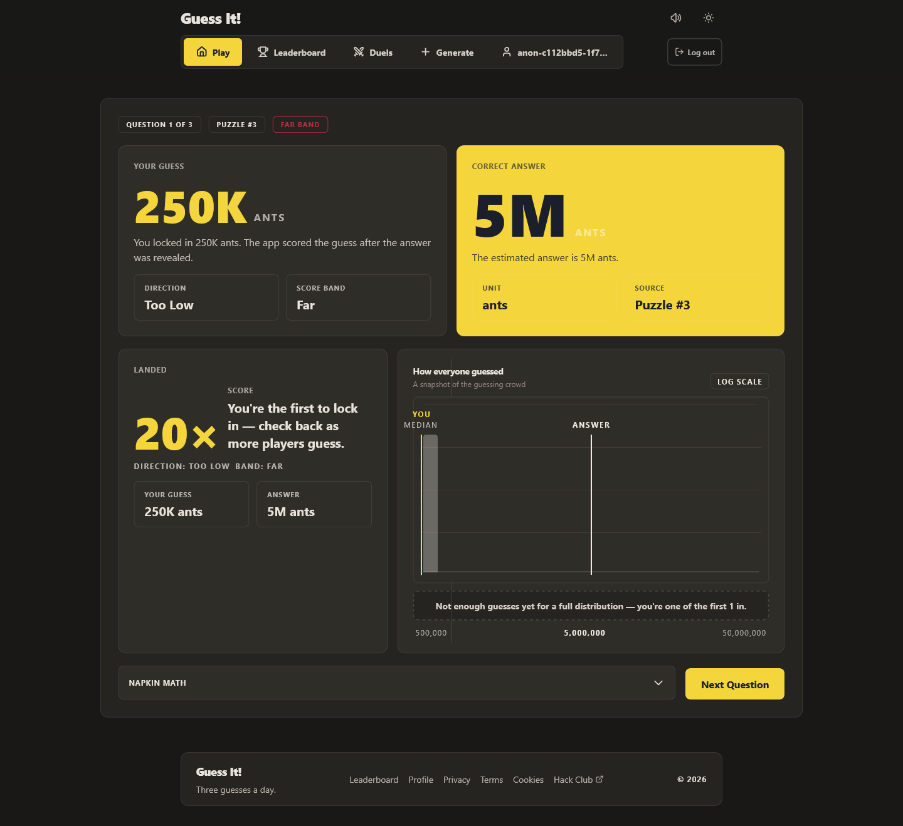

# Guess It!

A browser game where you guess things! Make an estimate, lock it in, and find out how close you got — then build a better instinct one puzzle at a time.

[](#)
[](#)
[](#)
[](#)
[](#)
[](#)

## Features

- **Daily puzzle** — three estimation questions a day, scored against the real answer
- **Scoring** — symmetric ratio scoring, so guessing 10× too high hurts exactly as much as guessing 10× too low
- **Reveal** — your score, direction, band, and rank among everyone who guessed
- **Guess distribution** — a log-scale chart showing where you landed in the crowd
- **Napkin math** — the reasoning behind the real answer, revealed after you commit
- **Streaks** — track consecutive days of play
- **Achievements** — badges for play streaks, exact guesses, and sharp averages
- **Public profiles** — bio, avatar upload, badges, streaks, and generated sets
- **Generate your own sets** — write three questions around a topic you pick
- **Duels** — real-time head-to-head estimates over a WebSocket
- **Friends and notifications** — send requests, get notified on friend requests and badges
- **Leaderboard** — daily, weekly, and all-time rankings
- **Accounts** — email and password, or Hack Club OAuth
- **Password reset** and **email verification**
- **Anonymous play** — start playing immediately, then migrate your progress when you sign up
- **Dark and light mode** with a persisted preference
- **Responsive UI** that works down to small phone widths

## Tech Stack

React 18, TypeScript, Vite, Tailwind CSS, React Router, Motion, Fastify 4, Prisma 5, PostgreSQL, Zod, `@google/genai`, Sharp, WebSockets, Vitest

## Preview

Landing page:



Make a guess:



See the result:



## Getting Started

Clone the repository:

```bash
git clone https://github.com/akisarke/guess-it.git
```

Open the project folder:

```bash
cd guess-it
```

Install dependencies and build the shared package:

```bash
npm install
npm run build -w shared
```

Create your environment file:

```bash
cp server/.env.example server/.env
```

You need at least a `DATABASE_URL` and a `SESSION_SECRET` of 32+ random characters:

```bash
openssl rand -base64 48
```

Then set up the database and start the app:

```bash
npx prisma migrate deploy --schema server/src/prisma/schema.prisma
npm run seed -w server     # optional: badges, starter questions, an owner account
npm run dev
```

The client runs on **http://localhost:5173** and proxies `/api` and `/uploads` to the server on port **3001**.

## Project Structure

```text
guess-it/
├── client/
│   ├── public/              # favicon, robots.txt, sitemap
│   └── src/
│       ├── components/      # UI, including duels/ and ui/
│       ├── hooks/           # auth gate, landing state, solo game
│       ├── lib/             # API client, scoring helpers, sounds, theme
│       ├── pages/           # one file per route
│       └── test/            # shared fixtures
├── server/
│   ├── src/
│   │   ├── errors/          # typed application errors and the HTTP error handler
│   │   ├── jobs/            # scheduled jobs
│   │   ├── middleware/      # authentication
│   │   ├── prisma/          # schema and migrations
│   │   ├── routes/          # one file per resource
│   │   ├── security/        # CSRF, origin policy, HTTP policy
│   │   └── services/        # business logic, including duels/
│   └── .env.example
├── shared/                  # types, scoring, and error codes used by both sides
├── screenshots/
└── package.json             # npm workspaces root
```

## How It Works

1. The player opens the landing page and starts today's puzzle.
2. An anonymous session is created so play can begin without an account.
3. The daily puzzle — three questions — is loaded for today.
4. The player types an estimate and locks it in; the guess is recorded.
5. The answer is revealed along with the score, direction, and band.
6. A distribution chart shows every guess, with markers for the player, the median, and the answer.
7. The napkin math explaining the real answer is revealed.
8. Streaks, badges, and leaderboard standings update from the new guess.
9. Signing up migrates the anonymous session and its progress to a real account.

## Scoring

Each guess is scored as a symmetric ratio against the real answer:

```js
score = Math.max(guess / answer, answer / guess)
```

Because the ratio is inverted and compared, guessing too high and guessing too low are penalised identically. A score of **1.0×** is exact, and lower is better.

Scores fall into three bands:

| Band | Score |
|---|---|
| Close | up to 1.5× |
| Medium | up to 3.0× |
| Far | above 3.0× |

A puzzle's average score is the arithmetic mean of its question scores.

## Supported Formats

### Accounts

- Email and password, hashed with scrypt
- Hack Club OAuth
- Anonymous play, upgradeable to a full account

### Avatars

- JPEG
- PNG
- WebP
- GIF

Up to 50 MiB. Images are re-encoded with Sharp on upload. SVG is not accepted.

## Performance

- Routes are lazy-loaded, so each page ships as its own chunk
- The client bundle is about 110 kB gzipped for the main chunk
- Images are downscaled before palette and chart work
- Guesses, streaks, and leaderboard queries are served by dedicated hot-path indexes
- Large images are processed off the main render path

## Privacy

User data is handled on the server, but image uploads never touch a third party:

- Avatars are re-encoded and stored outside the web root
- Public profile bios are rendered through a constrained parser that allows no raw HTML
- Badge icons are deterministic components selected by ID — user-supplied icon URLs are rejected
- Row Level Security keeps the anonymous database role away from user data

## Tests

```bash
npm test
```

307 tests across the three workspaces — 210 server, 87 client, and 10 shared. The server suite exercises routing, authentication, CSRF, rate limiting, and origin policy through Fastify's request injection rather than a live socket.

## Scripts

| Command | What it does |
|---|---|
| `npm run dev` | Runs the client and server together |
| `npm run build` | Builds `shared`, then `client`, then `server` |
| `npm test` | Runs all three test suites |
| `npm run migrate -w server` | Runs a Prisma migration |
| `npm run seed -w server` | Seeds badges, questions, and an owner |
| `npm run generate:daily -w server` | Generates the daily puzzle on demand |
| `npm run reset:users -w server` | Resets user data for local work |

## License

This project is licensed under the MIT License. See [LICENSE](LICENSE).
